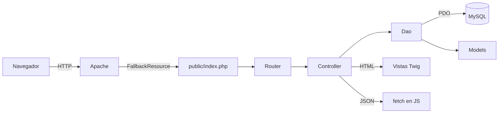
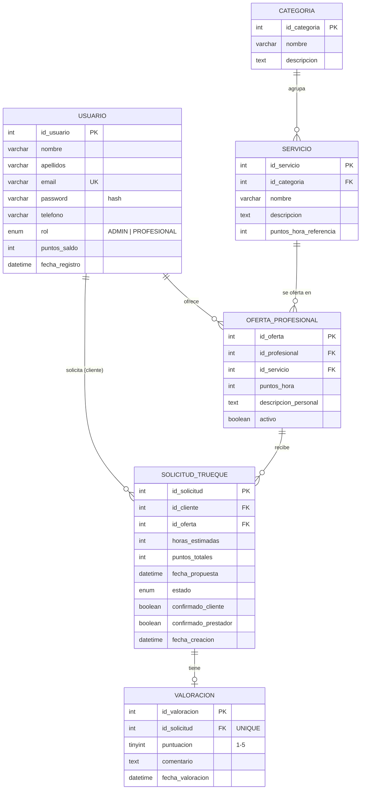
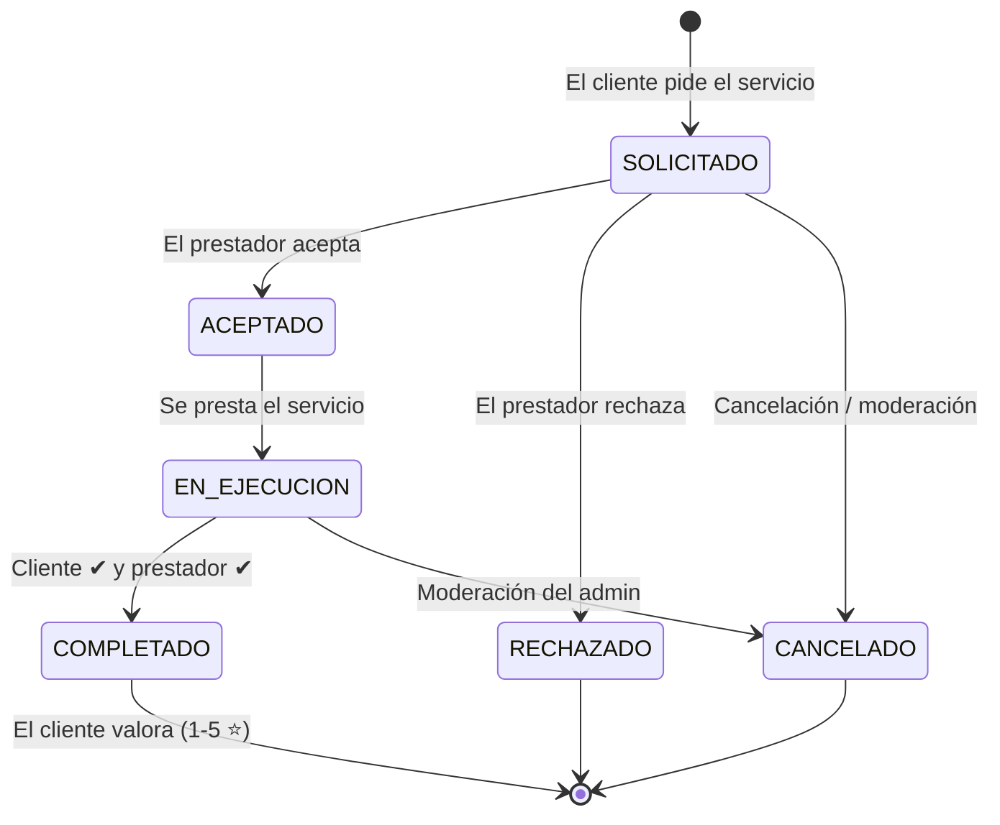

<div align="center">

# 🔄 Trueque de Servicios

**Plataforma web de trueque de servicios profesionales basada en un sistema de puntos por hora.**

Presta un servicio, gana puntos. Usa esos puntos para contratar el servicio que necesites a cualquier otro profesional de la comunidad.


[Qué es](#-qué-es) · [Puesta en marcha](#-puesta-en-marcha-con-docker) · [Arquitectura](#-arquitectura) · [Base de datos](#-base-de-datos) · [Problemas comunes](#-problemas-comunes)

</div>

---

## 📖 Qué es

**Trueque de Servicios** es una aplicación web **no lucrativa** de economía colaborativa. Fontaneros, electricistas, informáticos, profesores y otros profesionales intercambian servicios usando **puntos** en lugar de dinero.

El intercambio **no tiene que ser recíproco** entre las mismas dos personas:

```
Ana arregla el ordenador de Luis      →  Ana gana 20 puntos
Ana usa esos puntos con Marta (clases) →  Ana gasta 20 puntos, Marta los gana
```

Cada usuario acumula puntos prestando servicios a cualquier miembro y los canjea después con quien quiera.

> Proyecto integrador del **CFGS Desarrollo de Aplicaciones Web (DAW)**.

---

## ✨ Funcionalidades

| Módulo | Qué incluye |
|---|---|
| 👤 **Usuarios y autenticación** | Registro de profesionales con **saldo de puntos de bienvenida** · Login / logout con sesiones · Roles `ADMIN` y `PROFESIONAL` |
| 📚 **Catálogo de servicios** | Catálogo global gestionado **solo por el administrador** (categoría + precio de referencia en puntos/hora) |
| 🧰 **Ofertas del profesional** | Cada profesional elige qué servicios ofrece, con su **tarifa propia** y una **descripción personal**, y puede activarlos o desactivarlos |
| 🔎 **Buscador** | Filtro por **categoría** · Ordenación por **valoración media** del profesional (de mayor a menor) |
| 🔄 **Trueques** | Solicitud con fecha propuesta · Aceptar / rechazar desde la agenda · **Doble confirmación** antes de mover puntos |
| ⭐ **Valoraciones** | Puntuación de **1 a 5 estrellas** + comentario tras completar el servicio |
| 💰 **Saldo en tiempo real** | El saldo del panel personal se actualiza **sin recargar la página** |
| 🛡️ **Panel de administración** | CRUD de usuarios, categorías y servicios · Historial global de trueques · Moderación (dar de baja usuarios, cancelar solicitudes, moderar reseñas) |

---

## 🛠️ Tecnologías

| Capa | Tecnología |
|---|---|
| Backend | **PHP 8.2** orientado a objetos con tipado estricto (`declare(strict_types=1)`) |
| Servidor | **Apache 2.4** en contenedor Docker |
| Base de datos | **MySQL 8.0** con acceso mediante **PDO** y sentencias preparadas |
| Plantillas | **Twig 3**, instalado con **Composer** |
| Frontend | **JavaScript Vanilla (ES6+)**: módulos, `fetch`, event listeners y manipulación del DOM |
| Maquetación | **HTML5 semántico** + **CSS3 nativo** (Flexbox, Grid, variables CSS, responsive). **Sin frameworks CSS** |
| Infraestructura | **Docker** + **Docker Compose** |
| Depuración | **Xdebug 3** integrado con VS Code |

**Patrones de diseño:** MVC · DAO · arquitectura híbrida SPA (Twig renderiza en el servidor y JavaScript carga módulos y datos sin recargar).

---

## 🚀 Puesta en marcha con Docker

### Requisitos

| Herramienta | Para qué | Comprobar |
|---|---|---|
| [Docker Desktop](https://www.docker.com/products/docker-desktop/) | Levantar Apache + PHP + MySQL | `docker -v` |
| [Git](https://git-scm.com/) | Clonar el repositorio | `git -v` |
| [Composer](https://getcomposer.org/) *(opcional)* | Instalar Twig desde tu ordenador | `composer -V` |

> No necesitas tener PHP ni MySQL instalados en tu ordenador: todo corre dentro de Docker.

### 1. Clonar el repositorio

```bash
git clone https://github.com/yyerayjurado/proyecto-noviembre.git
cd proyecto-noviembre
```

### 2. Instalar dependencias (Twig)

La carpeta `vendor/` no se sube al repositorio, así que hay que generarla. Puedes hacerlo de dos formas:

**Con Composer instalado en tu ordenador:**
```bash
composer install
```

**Sin Composer, usando su imagen oficial de Docker:**
```bash
docker run --rm -v "$PWD":/app -w /app composer install
```

> En Windows (PowerShell) cambia `"$PWD"` por `${PWD}`.

### 3. Levantar los contenedores

```bash
docker compose up -d --build
```

La primera vez tarda unos minutos porque construye la imagen de PHP y descarga MySQL. Durante ese arranque inicial, MySQL ejecuta automáticamente los scripts de `database/`:

1. `01_schema.sql`: crea las tablas.
2. `02_seeds.sql`: inserta los datos de prueba.

### 4. Abrir la aplicación

| Servicio | URL / Host |
|---|---|
| 🌐 Aplicación | **http://localhost:8080** |
| 🗄️ MySQL (desde fuera de Docker) | `localhost:3306` |

Para comprobar que todo está en marcha:
```bash
docker compose ps
```
Los dos servicios (`app` y `db`) deben aparecer con estado **running**.

### 5. Usuarios de prueba

<!-- TODO: actualizar cuando estén creados los seeds en database/02_seeds.sql -->

| Rol | Email | Contraseña |
|---|---|---|
| Administrador | `admin@trueque.test` | `admin1234` |
| Profesional | `profesional@trueque.test` | `prof1234` |

---

## ⚙️ Configuración

Las credenciales de la base de datos se pasan a PHP como **variables de entorno** desde `docker-compose.yml`, así que no hay contraseñas escritas en el código.

| Variable | Valor por defecto | Uso |
|---|---|---|
| `DB_HOST` | `db` | Nombre del servicio MySQL en la red de Docker |
| `DB_NAME` | `trueque_servicios` | Base de datos |
| `DB_USER` | `usuario` | Usuario de la aplicación |
| `DB_PASS` | `usuario` | Contraseña de la aplicación |

En PHP se leen con `getenv('DB_HOST')`, etc., desde `src/Dao/Database.php`.

**Conexión a MySQL con un cliente externo** (MySQL Workbench, DBeaver, TablePlus…):

| Campo | Valor |
|---|---|
| Host | `127.0.0.1` |
| Puerto | `3306` |
| Usuario / contraseña | `usuario` / `usuario` (o `root` / `root`) |
| Base de datos | `trueque_servicios` |

---

## 🧭 Comandos útiles

| Acción | Comando |
|---|---|
| Arrancar | `docker compose up -d` |
| Arrancar reconstruyendo la imagen (tras cambiar el `Dockerfile`) | `docker compose up -d --build` |
| Parar | `docker compose down` |
| Ver logs de PHP / Apache | `docker compose logs -f app` |
| Ver logs de MySQL | `docker compose logs -f db` |
| Entrar en el contenedor de PHP | `docker compose exec app bash` |
| Abrir la consola de MySQL | `docker compose exec db mysql -u usuario -pusuario trueque_servicios` |
| **Reiniciar la base de datos desde cero** ⚠️ | `docker compose down -v && docker compose up -d` |

> ⚠️ `down -v` **borra el volumen de MySQL y todos sus datos**. Úsalo cuando cambies `01_schema.sql` o `02_seeds.sql`, porque esos scripts solo se ejecutan cuando la base de datos se crea por primera vez.

---

## 🏗️ Arquitectura

### Flujo de una petición



- **Todas las peticiones entran por `public/index.php`** (front controller). Apache redirige cualquier ruta que no sea un archivo real con `FallbackResource`.
- El **Router** decide qué método del **Controller** ejecutar.
- El **Controller** pide los datos al **Dao**. El Dao es la única capa que habla con la base de datos y devuelve objetos **Model**.
- El Controller responde de una de dos formas:
  - **HTML** renderizado con **Twig**, para las páginas completas.
  - **JSON**, para las peticiones `fetch` de JavaScript (la parte SPA).

### Estructura de carpetas

```
proyecto-noviembre/
├── docker/
│   ├── Dockerfile              # PHP 8.2 + Apache + pdo_mysql + Xdebug
│   └── xdebug.ini              # Configuración de depuración
├── docker-compose.yml          # Servicios: app (PHP/Apache) y db (MySQL)
├── composer.json               # Dependencias (Twig)
│
├── database/
│   ├── 01_schema.sql           # Creación de tablas
│   └── 02_seeds.sql            # Datos de prueba
│
├── public/                     # 🔓 Única carpeta accesible desde el navegador
│   ├── index.php               # Front controller
│   └── assets/
│       ├── css/                # Variables, base, layout y componentes
│       ├── js/
│       │   ├── app.js          # Arranque de la SPA
│       │   ├── api.js          # Envoltorio de fetch
│       │   └── modules/        # buscador, ofertas, solicitudes, agenda, valoraciones, saldo, admin
│       └── img/
│
├── src/                        # 🔒 Código PHP (namespace App\)
│   ├── App.php                 # Arranque de la aplicación
│   ├── Autoloader.php          # Carga automática de clases
│   ├── Router.php              # Enrutado de URLs a controladores
│   ├── Controllers/            # Lógica de cada sección (Controller base + uno por módulo)
│   ├── Dao/                    # Acceso a datos con PDO (Database + un Dao por tabla)
│   ├── Models/                 # Entidades + enums (Rol, EstadoSolicitud)
│   └── Views/                  # Plantillas Twig
│       ├── layout.html.twig
│       ├── partials/           # header, nav, footer, mensajes flash
│       ├── components/         # Fragmentos reutilizables (tarjeta de oferta, estrellas…)
│       └── auth/ home/ perfil/ servicios/ agenda/ admin/
│
└── docs/
    ├── manual-despliegue.md
    └── diario-ia.md            # Diario de uso de IA
```

> 🔒 **Seguridad:** Apache solo sirve la carpeta `public/`. El código PHP, las plantillas, `vendor/` y los scripts SQL **no son accesibles desde el navegador**.

---

## 🗄️ Base de datos

### Diagrama Entidad-Relación



**Restricciones clave:**
- `OFERTA_PROFESIONAL`: `UNIQUE (id_profesional, id_servicio)`. Un profesional no puede ofrecer el mismo servicio dos veces.
- `VALORACION.id_solicitud` es `UNIQUE`, así que cada trueque se valora **una sola vez**.
- La solicitud no copia los datos de la oferta: apunta a `id_oferta` y de ahí se obtienen el prestador y el servicio. Solo se guarda `puntos_totales`, para conservar el precio acordado aunque el profesional cambie su tarifa más adelante.

---

## 🔄 Ciclo de vida de un trueque



**Doble confirmación antiabuso:** el trueque solo pasa a `COMPLETADO` cuando **cliente y prestador** han marcado el servicio como finalizado (`confirmado_cliente` y `confirmado_prestador`).

**Transferencia de puntos atómica:** al completarse, se descuentan los puntos al cliente, se suman al prestador y se cambia el estado **dentro de una misma transacción PDO** (`beginTransaction` → `commit`, o `rollBack` si algo falla). Así nunca se pierden ni se duplican puntos.

---

## 🐞 Depuración con Xdebug

El contenedor incluye **Xdebug 3**, configurado para conectar con VS Code.

1. Instala la extensión **PHP Debug** (xdebug.php-debug).
2. Crea `.vscode/launch.json`:

```json
{
  "version": "0.2.0",
  "configurations": [
    {
      "name": "Xdebug (Docker)",
      "type": "php",
      "request": "launch",
      "port": 9003,
      "pathMappings": {
        "/var/www/html": "${workspaceFolder}"
      }
    }
  ]
}
```

3. Pulsa **F5**, pon un breakpoint y recarga http://localhost:8080.

---

## 🧯 Problemas comunes

<details>
<summary><b>❌ <code>port is already allocated</code> (puerto 8080 o 3306 ocupado)</b></summary>

Hay otro programa usando ese puerto, por ejemplo un MySQL instalado en tu ordenador. Cambia el puerto de la izquierda en `docker-compose.yml`:

```yaml
ports:
  - "3307:3306"   # en vez de "3306:3306"
```
</details>

<details>
<summary><b>❌ <code>Failed opening required '.../vendor/autoload.php'</code></b></summary>

Falta instalar las dependencias. Ejecuta el [paso 2](#2-instalar-dependencias-twig).
</details>

<details>
<summary><b>❌ He cambiado el <code>.sql</code> y la base de datos no cambia</b></summary>

Los scripts de `database/` solo se ejecutan la **primera vez** que se crea la base de datos. Reiníciala (⚠️ borra los datos):

```bash
docker compose down -v
docker compose up -d
```
</details>

<details>
<summary><b>❌ <code>SQLSTATE[HY000] [2002] Connection refused</code> justo al arrancar</b></summary>

MySQL tarda unos segundos en estar listo la primera vez. Espera un poco y recarga. Puedes seguir el arranque con `docker compose logs -f db` hasta que aparezca `ready for connections`.
</details>

<details>
<summary><b>❌ Todas las rutas dan 404 excepto la portada</b></summary>

La imagen está desactualizada. Reconstrúyela para que se aplique la configuración de `FallbackResource`:

```bash
docker compose up -d --build
```
</details>

---

## 📄 Documentación

| Documento | Contenido |
|---|---|
| [`docs/manual-despliegue.md`](docs/manual-despliegue.md) | Manual de despliegue del entorno Docker |
| [`docs/diario-ia.md`](docs/diario-ia.md) | Diario de uso de IA (prompts, resultados, motivos y aprendizajes) |
| Diagrama E/R | [Sección Base de datos](#-base-de-datos) |
| Diagrama de clases MVC | <!-- TODO: añadir docs/diagrama-clases.png --> *Pendiente* |

---

## 👤 Autor

**Yeray Jurado Vela**
CFGS Desarrollo de Aplicaciones Web · IES Las Fuentezuelas (Jaén)

<div align="center">

<sub>Proyecto académico sin ánimo de lucro.</sub>

</div>
