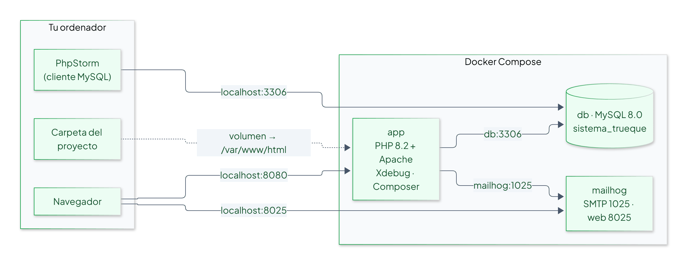
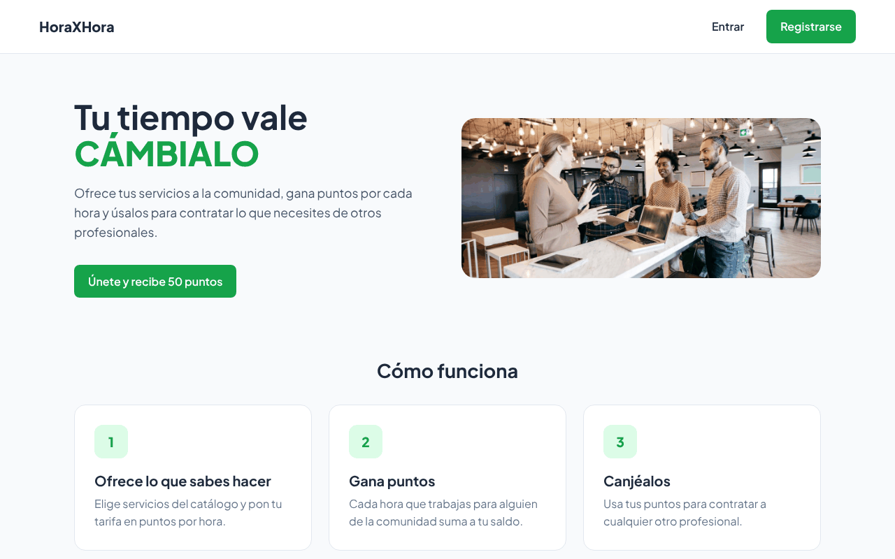
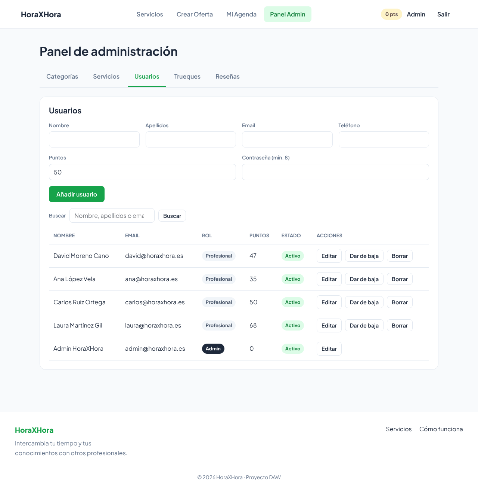
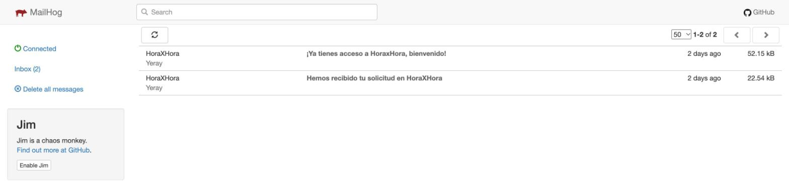
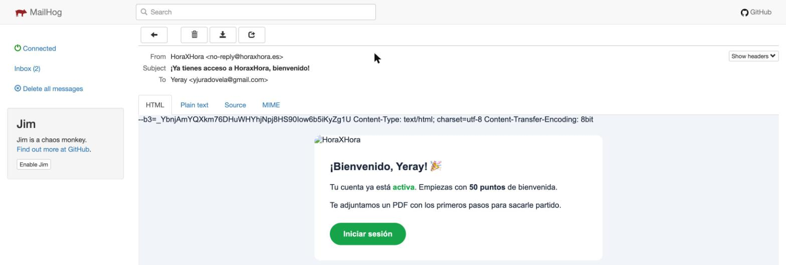

# Manual de despliegue — HoraXHora

Guía para poner en marcha **HoraXHora** (plataforma de trueque de servicios) en cualquier ordenador usando Docker. Al terminar tendrás la aplicación, la base de datos con datos de prueba y un servidor de correo de pruebas funcionando con un solo comando.

---

## 1. Qué se despliega

La aplicación se compone de tres contenedores definidos en `docker-compose.yml`:

| Servicio | Imagen | Para qué sirve | Puerto en tu ordenador |
|---|---|---|---|
| `app` | `php:8.2-apache` (con el `Dockerfile` del proyecto) | Servidor web con PHP 8.2, Apache, PDO MySQL, Xdebug y Composer | `8080` |
| `db` | `mysql:8.0` | Base de datos `sistema_trueque` | `3306` |
| `mailhog` | `mailhog/mailhog` | Servidor de correo de pruebas: recoge los correos que envía la app sin mandarlos de verdad | `1025` (SMTP) y `8025` (web) |



Dentro de Docker los contenedores se comunican por el **nombre del servicio** (`db`, `mailhog`), no por `localhost`.

---

## 2. Requisitos

| Herramienta | Para qué | Cómo comprobarlo |
|---|---|---|
| [Docker Desktop](https://www.docker.com/products/docker-desktop/) | Levantar los contenedores | `docker -v` y `docker compose version` |
| [Git](https://git-scm.com/) | Descargar el repositorio | `git -v` |

No hace falta tener instalado PHP, MySQL, Apache ni Composer en el ordenador: todo funciona dentro de Docker.

Antes de empezar, **abre Docker Desktop** y espera a que esté en marcha.

---

## 3. Descargar el proyecto

```bash
git clone https://github.com/yyerayjurado/proyecto-noviembre.git
cd proyecto-noviembre
```

> El repositorio es privado: hace falta tener acceso con tu cuenta de GitHub.

Estructura que necesita el despliegue:

```
proyecto-noviembre/
├── Dockerfile            # Imagen de PHP 8.2 + Apache
├── docker-compose.yml    # Los tres servicios
├── apache.conf           # DocumentRoot en public/ y AllowOverride All
├── xdebug.ini            # Configuración de Xdebug
├── composer.json         # Dependencias: Twig, PHPMailer y Dompdf
├── database/
│   ├── 01_schema.sql     # Crea las tablas
│   └── 02_seeds.sql      # Datos de prueba
├── public/               # Única carpeta accesible desde el navegador
│   ├── index.php
│   └── .htaccess         # Manda todas las rutas a index.php
├── src/                  # Código PHP (namespace App\)
└── templates/            # Plantillas Twig, correos y PDF
```

---

## 4. Levantar los contenedores

Desde la carpeta del proyecto:

```bash
docker compose up -d --build
```

- `--build` construye la imagen de PHP a partir del `Dockerfile`. Solo es necesario la primera vez o cuando cambies el `Dockerfile`.
- `-d` deja los contenedores funcionando en segundo plano.

La primera vez tarda unos minutos porque descarga las imágenes. Durante ese primer arranque, MySQL ejecuta automáticamente y en orden los scripts de `database/`:

1. `01_schema.sql`: crea las tablas.
2. `02_seeds.sql`: inserta los datos de prueba.

Comprueba que los tres servicios están en marcha:

```bash
docker compose ps
```

`app`, `db` y `mailhog` deben aparecer con estado **running** (o **Up**).

---

## 5. Instalar las dependencias

La carpeta `vendor/` no se sube al repositorio (está en `.gitignore`), así que hay que generarla. El contenedor `app` ya trae Composer instalado:

```bash
docker compose exec app composer install
```

Esto instala **Twig**, **PHPMailer** y **Dompdf** y genera el autoload PSR-4 (`App\` → `src/`). Como el código está montado como volumen, `vendor/` aparece también en tu carpeta del proyecto.

> Si tienes Composer instalado en tu ordenador, también vale `composer install` desde la carpeta del proyecto.

---

## 6. Abrir la aplicación

| Qué | Dirección |
|---|---|
| Aplicación | **http://localhost:8080** |
| Bandeja de correo (MailHog) | **http://localhost:8025** |
| MySQL desde fuera de Docker | `localhost:3306` |

Si todo ha ido bien, en http://localhost:8080 verás la página de inicio:



### Usuarios de prueba

Todos los usuarios de los seeds tienen la contraseña **`1234`**.

| Rol | Email |
|---|---|
| Administrador | `admin@horaxhora.es` |
| Profesional | `laura@horaxhora.es` |
| Profesional | `carlos@horaxhora.es` |
| Profesional | `ana@horaxhora.es` |
| Profesional | `david@horaxhora.es` |

Las contraseñas están guardadas en la base de datos con hash bcrypt, nunca en texto plano.

Para comprobar que la base de datos está bien cargada, entra como `admin@horaxhora.es` y abre el **Panel Admin**: deben aparecer los 5 usuarios de prueba.



---

## 7. Configuración

Los datos de conexión no están escritos en el código: se pasan a PHP como **variables de entorno** desde `docker-compose.yml` y se leen con `getenv()`.

| Variable | Valor | Dónde se usa |
|---|---|---|
| `DB_HOST` | `db` | `src/Dao/BD.php` |
| `DB_NAME` | `sistema_trueque` | `src/Dao/BD.php` |
| `DB_USER` | `usuario` | `src/Dao/BD.php` |
| `DB_PASS` | `usuario` | `src/Dao/BD.php` |
| `MAIL_HOST` | `mailhog` | `src/Service/MailOptions.php` |
| `MAIL_PORT` | `1025` (por defecto) | `src/Service/MailOptions.php` |

Para cambiar un valor, se edita en `docker-compose.yml` y se reinicia con `docker compose up -d`.

### Apache

El archivo `apache.conf` sustituye la configuración por defecto del contenedor:

- `DocumentRoot /var/www/html/public`: solo la carpeta `public/` es accesible desde el navegador. El código de `src/`, las plantillas y los `.sql` quedan fuera.
- `AllowOverride All`: permite que funcione el `.htaccess` de `public/`, que manda todas las URLs que no son un archivo real a `index.php` (rutas amigables como `/login` o `/agenda`).

---

## 8. Base de datos

### Conectarse desde PhpStorm u otro cliente

| Campo | Valor |
|---|---|
| Host | `localhost` |
| Puerto | `3306` |
| Usuario / contraseña | `usuario` / `usuario` (o `root` / `root`) |
| Base de datos | `sistema_trueque` |

> Desde fuera de Docker se usa `localhost`. La aplicación, desde dentro, usa `db`.

### Abrir la consola de MySQL

```bash
docker compose exec db mysql -u usuario -pusuario sistema_trueque
```

### Reiniciar la base de datos desde cero

Los scripts de `database/` **solo se ejecutan la primera vez** que se crea la base de datos. Si cambias `01_schema.sql` o `02_seeds.sql`, hay que borrar el volumen para que se vuelvan a ejecutar:

```bash
docker compose down -v
docker compose up -d
```

> ⚠️ `down -v` borra el volumen `db_data` y **todos los datos** de la base de datos (usuarios registrados, trueques, valoraciones...). Después se vuelve a quedar solo con los datos de prueba.

---

## 9. Correo de pruebas (MailHog)

La aplicación envía correos al registrarse un usuario y cuando el administrador aprueba o rechaza una cuenta (al aprobar se adjunta un PDF de bienvenida generado con Dompdf).

En este entorno los correos **no se envían de verdad**: los recoge MailHog y se ven en **http://localhost:8025**.



Al abrir el correo de cuenta aprobada se ve el mensaje con el botón de iniciar sesión:



- MailHog no muestra bien en la pestaña HTML los correos con imágenes incrustadas (el banner con `cid`): en la captura se ve que el banner no carga y que aparecen las cabeceras de las partes del mensaje. El correo es correcto: se puede comprobar en la pestaña **Source** o descargándolo y abriéndolo en un cliente de correo.
- Si el envío de un correo falla, la acción no se bloquea (el usuario se aprueba igualmente) y el error queda en el log de PHP.

Para usar un servidor de correo real habría que cambiar `MAIL_HOST` y `MAIL_PORT` y añadir usuario, contraseña y cifrado (`tls` o `ssl`) en `MailOptions`.

---

## 10. Depuración con Xdebug

Xdebug viene instalado y configurado en `xdebug.ini`:

| Opción | Valor |
|---|---|
| `xdebug.mode` | `debug` |
| `xdebug.start_with_request` | `yes` (se activa en cada petición) |
| `xdebug.client_host` | `host.docker.internal` (tu ordenador visto desde Docker) |
| `xdebug.client_port` | `9003` |

En **PhpStorm**: *Settings → PHP → Servers*, añade un servidor `localhost` en el puerto `8080` y marca **Use path mappings**, relacionando la carpeta del proyecto con `/var/www/html`. Después activa **Start Listening for PHP Debug Connections** y pon un punto de interrupción.

---

## 11. Comandos útiles

| Acción | Comando |
|---|---|
| Arrancar | `docker compose up -d` |
| Arrancar reconstruyendo la imagen | `docker compose up -d --build` |
| Ver el estado | `docker compose ps` |
| Parar | `docker compose down` |
| Ver los logs de PHP / Apache | `docker compose logs -f app` |
| Ver los logs de MySQL | `docker compose logs -f db` |
| Entrar en el contenedor de PHP | `docker compose exec app bash` |
| Instalar dependencias | `docker compose exec app composer install` |
| Regenerar el autoload | `docker compose exec app composer dump-autoload` |
| Reiniciar la base de datos ⚠️ | `docker compose down -v && docker compose up -d` |

---

## 12. Problemas comunes

| Problema | Causa | Solución |
|---|---|---|
| `port is already allocated` al arrancar | Otro programa usa el puerto (por ejemplo, un MySQL o XAMPP instalado en el ordenador usa el 3306) | Para ese programa o cambia el puerto de fuera en `docker-compose.yml`, por ejemplo `"3307:3306"`. El de dentro no se toca |
| `Failed opening required '.../vendor/autoload.php'` | No se han instalado las dependencias | `docker compose exec app composer install` |
| `Class "App\..." not found` | El nombre del archivo, de la carpeta o del `namespace` no coincide exactamente con la clase. En Mac funciona aunque no coincidan las mayúsculas, pero en Docker (Linux) no | Revisa que `UsuarioDao.php` contenga `class UsuarioDao`, que la carpeta sea `Service` y no `service`, etc. Después, `composer dump-autoload` |
| Error 403 Forbidden | Apache no está usando `apache.conf` o falta `AllowOverride All` | Comprueba el `COPY apache.conf` del `Dockerfile` y reconstruye con `docker compose up -d --build` |
| Error 404 en todas las rutas menos `/` | No funciona el `.htaccess` (falta `mod_rewrite` o `AllowOverride All`) | El `Dockerfile` ya activa `mod_rewrite`; reconstruye la imagen |
| `No se ha podido conectar con la base de datos` | MySQL todavía está arrancando o las credenciales no coinciden | Espera unos segundos y recarga. Si sigue, revisa `docker compose logs db` y las variables `DB_*` |
| Cambios en los `.sql` que no aparecen | Los scripts solo se ejecutan al crear la base de datos | `docker compose down -v && docker compose up -d` |
| Los acentos salen mal | Conexión o importación sin `utf8mb4` | `02_seeds.sql` lleva `SET NAMES utf8mb4` y la conexión PDO usa `charset=utf8mb4`; reinicia la base de datos |
| Los cambios del CSS o JS no se ven | Caché del navegador | Recarga forzada: `Cmd + Shift + R` (Mac) o `Ctrl + F5` (Windows) |
| No llegan los correos | Se están buscando en un correo real | Los correos se ven en http://localhost:8025 |

---

## 13. Parar y eliminar

```bash
# Parar los contenedores (los datos de la BD se conservan)
docker compose down

# Parar y borrar también los datos de la base de datos
docker compose down -v
```

Para liberar espacio, las imágenes descargadas se pueden borrar desde Docker Desktop (apartado *Images*).

---

## 14. Nota sobre producción

Esta configuración es para **desarrollo y corrección**. Para publicar la aplicación en un servidor real habría que, como mínimo:

- Cambiar todas las contraseñas (`root`, `usuario`) y no dejarlas escritas en `docker-compose.yml`.
- Quitar Xdebug y no publicar el puerto `3306` de MySQL.
- Sustituir MailHog por un servidor SMTP real con cifrado.
- Servir la web por HTTPS.
